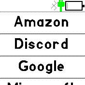
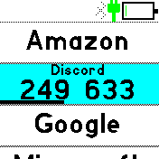
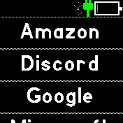
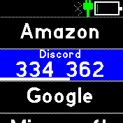

# Authentiwatch - 2FA Authenticator

* GitHub: https://github.com/andrewgoz/Authentiwatch <-- Report bugs here
* Bleeding edge AppLoader: https://andrewgoz.github.io/Authentiwatch/

## Important!

Tokens are stored *ONLY* on the watch. Make sure you do one or more of the following:

* Make a backup copy of the "authentiwatch.json" file.
* Export all your tokens to another device or print the QR code.

Keep those copies safe and secure.

## Supports

* Google Authenticator compatible 2-factor authentication
* Hash calculations:
  * Bangle 1: SHA1 only (same as Google Authenticator)
  * Bangle 2: All (SHA1, SHA256, SHA512)
* Timed (TOTP) and Counter (HOTP) modes
* Custom periods
* Between 6 and 10 digits
* Phone/PC configuration web page:
  * Add/edit/delete/arrange tokens
  * Scan token and migration(import) QR codes
  * Produce scannable token and migration(export) QR codes

## Usage

* Use the Phone/PC web page interface to manage the tokens stored on the watch.
* Tokens are stored *ONLY* on the watch.
* Swipe right to exit to the app launcher.
* Swipe left on selected counter token to advance the counter to the next value.

   

## Creator

Andrew Gregory (andrew.gregory at gmail)

## Encryption (v0.08)

Tokens are stored in `authentiwatch.lock` as an authenticated ciphertext blob:

- **Cipher:** a SHA-256 keystream built from the firmware's crypto module (`ct = pt XOR SHA256(encKey || iv || be32(i))`, 32-byte blocks). The nRF firmware only exposes hashes to JS, so the cipher is hash-based rather than a hand-rolled AES.
- **Integrity:** encrypt-then-MAC; HMAC-SHA256 over `iv||ct` with a key derived separately from the encryption key, so a wrong PIN or a tampered file yields no data.
- **PIN:** a numeric PIN of 4-8 digits is entered on the watch keypad at every launch. The PIN never leaves the watch and is not stored anywhere; the store key comes from a 400-round SHA256 chain over `salt||PIN` (~2-4 s per unlock on a Bangle.js 2), split into an encryption key and a MAC key via domain separation ("enc"/"mac" labels).
- **Trusted session:** while the app stays open it remains decrypted for a configurable number of minutes (BTN1 held -> 2/5/15 min, default 5). Any reload, app switch or reboot asks for the PIN again.
- **Interoperability:** the store format is verified byte-for-byte against `tools/seal_lock.py`, a stdlib-only Python reference implementation in this directory. It can seal a new blob from a tokens JSON, verify an existing blob's tag, and show its token labels without revealing contents.
- **IV/salt quality:** the nRF52840 hardware RNG is not exposed to JS on 2v29, so IVs/salt mix an erase-free boot counter (which makes IV reuse impossible across reboots), wall-clock time, the temperature sensor and `Math.random`, hashed through SHA256. A fresh salt is chosen at every (re)set.
- **What this protects:** a flash dump, a Storage-level file pull (app-loader backups, the Gadgetbridge storage browser) yields nothing without the PIN. What it cannot protect: the paired phone (with BLE console access) and an unlocked session, plus offline guessing of short PINs (the PIN's own entropy is the ceiling). A 6-digit PIN stretched 400x costs minutes of single-core commodity CPU per full sweep; longer PINs scale that cost directly.

## Buttons

- Launch → PIN keypad. Entering shows dots; OK applies (4–8 digits).
- BTN1 tap (short) → leave to launcher (session wiped from RAM).
- BTN1 held ~2.5 s at the PIN gate → *Import* plaintext `authentiwatch.json` into the encrypted store, or *Wipe* the store entirely (destructive: secrets must be re-provisioned afterwards).
- BTN1 held ~2.5 s inside the app → change PIN or set the trusted-session length.

### Migration

After installing 0.08 with a plaintext `authentiwatch.json` present, the first launch asks for a new PIN (twice), encrypts the existing tokens, erases the plaintext file, and continues.
