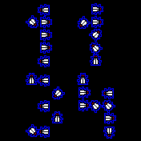

# FliesClock (White on Black)

Flies form the digits of the time on a black background: hours on top, minutes below, one fly per cell of a thinned 3 × 5 grid.

## Usage

- Every minute the flies that are no longer needed take off and fly to the nearest new place. Missing flies come in from the edge, surplus flies leave the screen.
- The flies land a little beside their place and walk the last bit.
- Touch a fly to make it jump away; it returns to its place afterwards.
- Shake the watch hard (three jolts within a second) to startle all flies.
- While the watch is locked, the flies take their new places without flying.

Widgets are hidden. The clock supports Fast Load.

## Battery

The animation only runs while a fly is flying or walking. Between minutes the watch sleeps until the next minute or a touch. Shake detection listens to the accelerometer, which wakes JavaScript at the sensor rate and costs a little power.

## See also

[FliesClock (Black on White)](https://banglejs.com/apps/?id=fliesclockneg) shows black flies on a white background.

## Creator

Meinolf Amekudzi ([microClocks](https://github.com/mamekudz/microClocks)). The fly sprites are based on flyex by the same author.
