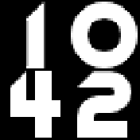

# Oxyd

Oxyd digits show the time on a black background: hours on top, minutes below.

The face is drawn when the minute changes. Between minutes the watch can sleep. Widgets are hidden. The clock supports Fast Load.

## Creator

Meinolf Amekudzi ([microClocks](https://github.com/mamekudz/microClocks)). The Oxyd digits are by the same author.
