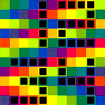

# Tegula Digital Art Clock

> **Time, set in tiles.**

Tegula (Latin for tile) turns your Bangle.js 2 into a mosaic. The screen is divided into 11 × 11 tiles that form a Lohse square, a color arrangement named after the Swiss painter Richard Paul Lohse. The time is laid over it in black tiles: hours at the top, minutes at the bottom. While the watch is unlocked, the mosaic turns paler for 2 seconds, then shows its own colors for 1 second, and two thin white lines show the view and the time until the screen locks. A small piece of Concrete Art on your wrist, new with every swipe up.

## Features

- **A new image anytime you swipe up** and after using other apps, including the launcher
- **More than 20 million different images**
- **Bold tile digits** in a retro font inspired by seven-segment displays
- **Date, seconds and flashlight**, each just one gesture away
- **Light pulse**, when the watch is unlocked, the mosaic turns paler for 2 seconds and back for 1 second, for better readability
- **Two thin white lines** when the watch is unlocked, the top one shows the view, the right one shrinks until the screen locks
- **Widgets on demand**, hidden until you swipe down

---

## System Settings

### Waking Up the Clock

Under _Settings → System → LCD_, configure which interactions wake the clock from sleep: Button, Tap, Double Tap, FaceUp or Twist. By default, only Button is switched on.

### LCD Timeout

Found under _Settings → System → LCD_. Determines how long the watch waits before going to sleep, which locks the touchscreen and switches off the backlight to save power. Default: 10 seconds. While the watch is unlocked, the white line on the right edge shrinks over this time.

### LCD Brightness

Found under _Settings → System → LCD_. Accepts a value between 0.0 and 1.0. A value of 0.3 is a good practical starting point.

### Time Sync, Summer and Winter Time

The Bangle only detects time changes when synced with a smartphone. If the time is off, correct it manually by adjusting the time zone under _Settings → System → Locale_.

GPS Time is a separate app, available in the App Loader. It sets the exact time from the built-in GPS and does not need a smartphone. Open it outdoors, wait until it shows the time and press Set. As it does not change the time zone, summer and winter time still require the setting above.

### Default Clock

Multiple watch faces can be installed on the Bangle. Make Tegula your default clock under _Settings → System → Clock_.

---

## Primary Views

While the watch is locked, Tegula shows the time (Hours/Minutes) in black digits and updates it once a minute.

The touchscreen only reacts while the watch is unlocked: press the button to unlock it. Swipe right for the date (Day/Month) and left for the seconds (Minutes/Seconds). Swipe the other way, or let the screen lock, to return to the time (Hours/Minutes). In every view, swipe up for a new image.

While the watch is unlocked, the whole mosaic turns paler for 2 seconds, then shows its own colors for 1 second, and so on. This makes the digits easier to read and shows that the touchscreen reacts. It runs in all three views, in the seconds view together with the seconds, and starts paler on every unlock and after every swipe.

Two thin white lines also appear while the watch is unlocked. The line at the top edge shows the view: the left third for the date, the middle third for the time, the right third for the seconds. The line on the right edge starts at full height and shrinks towards its center until the screen locks. Every touch starts it again, just as it restarts the LCD timeout of the watch. With an LCD timeout of 0 (never lock), only the top line is shown. Both lines disappear when the screen locks.

---

## Secondary Views

Widgets: Swipe down to show the widget bar over the top tiles. It hides after 2 seconds or on swipe up.

Flashlight: Access by **double-tapping the lower left corner**. Displays a full-brightness white screen. The LCD timeout is disabled while active. Tap anywhere to exit, which restores the previous brightness and re-enables the timeout.

---

## Design

### Richard Paul Lohse

Richard Paul Lohse (1902-1988) was a Swiss painter and graphic designer from Zurich and one of the leading figures of Concrete Art. In his paintings, he arranged colors in strict, systematic grids. He structured these grids so that each color had the same visual importance and no single color dominated the composition.

### Lohse Rules

The background displays random Lohse squares.

1. Every color appears exactly once in each row and column ('Latin square').
2. Tiles that touch at a corner never have the same color.
3. These rules also apply to the edges.

The image is built from the top down by shifting:

1. The clock uses 11×11 tiles and three color palettes of 11 colors each.
2. The first row randomly selects one out of the palettes.
3. Each subsequent row is the previous row shifted sideways, wrapping around at the end so that it starts with a color that no earlier row started with.

### Digits

The digit font was chosen carefully to fit into the tile grid of the background image. It is inspired by the retro design of seven-segment displays, known from early digital watches and calculators. Each digit is 4 tiles wide and 5 tiles high, so two rows of digits with one row between them fill exactly the 11 rows of the grid. A thin frame in the color underneath separates the black tiles.

### Light Pulse

The pulse makes all tiles paler by blending their colors with white. The black squares stay black, and after 2 seconds the tiles show their own colors again for 1 second, so the Lohse square stays intact.

### White Lines

Each line is 2 pixels wide and has a black line of 2 pixels on its inner side, as white alone would vanish on pale tiles. They cover only the outermost pixels of the mosaic, and the locked clock face shows no trace of them.

---

## Notice

The background images of the clock face are generated programmatically using random numbers and are therefore independent 'creations'. They do not constitute reproductions of Richard Paul Lohse's works.
